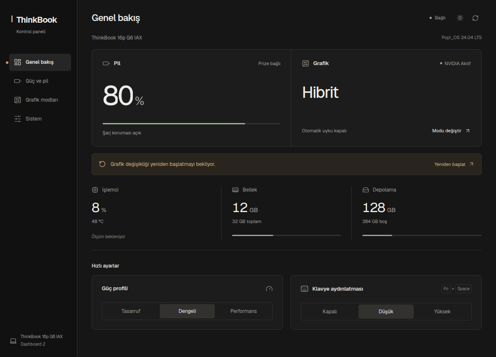

# ThinkBook Dashboard

A local desktop control panel for Lenovo ThinkBook laptops running Pop!_OS. Switch graphics modes, choose power profiles, and see battery and system status in a React + Rare UI interface hosted by Qt WebEngine.

The interface is in **Turkish**, with dark and light themes. No account, cloud service, or web server is needed to run it.



## Features

- **Graphics modes:** hybrid, integrated Intel, NVIDIA, and compute. Saved configuration and actual GPU runtime state are shown separately.
- **Power and firmware:** Pop!_OS power profiles, supported Lenovo firmware profiles, and an optional Fn+Q on-screen indicator.
- **Battery:** charge, capacity, health, cycle count, and conservation-mode status when exposed by Linux.
- **Keyboard lighting:** off, low, and high on two-step ThinkBook backlights, or an integer slider for devices with more levels; changes are verified through UPower.
- **System:** CPU load and temperature, memory, storage, session activity, and redacted diagnostic export.
- **Interface:** responsive layout, reduced-motion support, bundled fonts, and custom static hardware artwork.

The screenshot uses synthetic test readings. The desktop app reads the actual machine; it does not fall back to demonstration data.

## Compatibility

Developed and tested on a **ThinkBook 16p G6 IAX with Pop!_OS 24.04**, Intel integrated graphics and NVIDIA discrete graphics. Other hardware and distributions have not been validated. This is an independent project, not an official Lenovo or System76 application.

Graphics and power controls depend on `system76-power` and its system service. Firmware controls depend on Linux exposing `platform_profile` and `platform_profile_choices` under `/sys/firmware/acpi`. Unsupported readings appear as unavailable. The optional OSD requires a Wayland compositor with layer-shell support.

## Install from source

Use Python 3.10+ and Node.js 22.12+ (or Node.js 24). The UI dependencies are pinned in `ui/package-lock.json`.

On Pop!_OS / Ubuntu 24.04, install the desktop dependencies:

```bash
sudo apt update
sudo apt install git python3 python3-pyqt6 python3-pyqt6.qtwebengine python3-pyqt6.qtwebchannel upower
```

`system76-power` is supplied by Pop!_OS. Confirm it is available with `system76-power profile`. Installing this application does not install GPU drivers or configure another distribution's power-management service.

Build and install for your user:

```bash
git clone https://github.com/seriousopponent/thinkbook-dashboard.git
cd thinkbook-dashboard
npm ci --prefix ui
npm run build --prefix ui
python3 install.py
```

Open **ThinkBook Dashboard** from the application menu, or run:

```bash
/usr/bin/python3 ~/.local/share/thinkbook-dashboard/native.py
```

The installer copies the built UI and Python runtime into `~/.local/share/thinkbook-dashboard` and creates an application-menu launcher. It honors `XDG_DATA_HOME`, backs up an existing installation, and does not change GPU modes, power profiles, startup services, or system packages. Close the application before installing an update. Keep the source checkout to rebuild future updates.

### Optional GTK interface and Fn+Q indicator

```bash
sudo apt install python3-gi python3-gi-cairo python3-cairo gir1.2-gtk-3.0 gir1.2-gtklayershell-0.1
```

The launcher's **Klasik arayüzü aç** action opens the original GTK interface. Preview the firmware indicator from the dashboard or run `python3 osd.py --preview` from the checkout. The OSD remains a read-only profile observer until its process exits; automatic startup is not installed.

## Graphics switching and battery use

Select **Grafik modları**, choose a mode, and click **Modu uygula**. Graphics changes take full effect after a reboot. Rebooting requires a separate confirmation in the app. Integrated mode can disable external display ports wired to the NVIDIA GPU.

The “Discrete GPU is active” desktop warning reflects hardware state. Saving a different mode alone does not guarantee that the GPU has already suspended. The dashboard shows both saved mode and runtime state to make this distinction visible.

- Routine NVIDIA status uses sysfs; `nvidia-smi` runs only after **Bir kez ölç**, which may wake the GPU.
- Dashboard polling runs every four seconds while the UI is visible and focused. Power-service metadata is cached for twenty seconds.
- The desktop view disables GPU compositing and WebGL. Artwork is static and stored locally.
- Firmware changes use a `pkexec` authentication prompt; the entire dashboard should not run as root.

## Keyboard backlight

Open **Güç ve pil → Klavye aydınlatması** and choose **Kapalı**, **Düşük**, or **Yüksek**. The control uses the brightness steps reported by the device. On the tested ThinkBook these are 0, 1, and 2; it does not treat them as a 0–100 hardware range. ThinkBook's **Fn + Space** shortcut also changes the backlight; the dashboard refreshes its displayed level while focused.

Changes go through the documented [UPower keyboard backlight interface](https://upower.freedesktop.org/docs/KbdBacklight.html), using `busctl` from systemd. No direct sysfs write permissions or custom root helper are needed. If UPower is unavailable or the device does not expose a supported backlight, the panel shows the reason and omits the controls. Failed writes or a readback mismatch are reported as errors, without changing the displayed selection to the requested value.

## Development and verification

```bash
# Hardware/service tests: do not apply real settings
python3 -m unittest -v test_graphics test_service test_keyboard

# UI build and browser tests with a mocked Qt bridge
npm ci --prefix ui
npm run build --prefix ui
cd ui
npx playwright install chrome
npm test
cd ..

# On a graphical Linux desktop with Qt installed
/usr/bin/python3 native.py --smoke-test
```

The native smoke test uses the real read-only bridge and writes `/tmp/thinkbook-dashboard-native.png`. UI tests cover power changes and failures, graphics selection, reboot cancellation, explicit telemetry, responsive layout, themes, diagnostics, and missing native connections. `npm run dev --prefix ui` alone cannot control hardware; normal execution requires the Qt host.

| Path | Purpose |
| --- | --- |
| `native.py` | Desktop shell, local-only request policy, Qt bridge, single-instance handling |
| `service.py` | Fixed action list, serialized settings changes, verification and diagnostics |
| `hardware.py` | Linux hardware probes and system76-power integration |
| `keyboard.py` | UPower keyboard brightness discovery, validation and verified writes |
| `ui/src` | React, TypeScript, Tailwind and Rare UI components |
| `assets` | Original artwork and generation prompts |
| `install.py` | User-level runtime and launcher installation |

## Artwork and credits

The energy capsule, processor, memory, storage, and laptop illustrations were generated with ImageGen. Original transparent PNGs are in `assets/originals`; the UI uses lossless WebP files in `ui/src/assets`. These are decorative concepts, not exact branded product photographs or live indicators. Generation prompts are included in [the energy manifest](assets/energy-capsule-v1.json) and [the hardware manifest](assets/hardware-set-v1.json).

[Bounce Sidebar and Animated Counter from Rare UI](https://rareui.com), by [Swami Malode](https://github.com/swamimalode07/rare-ui), are adapted for local desktop navigation and reduced-motion handling. Their MIT notice is preserved in [ui/licenses/rare-ui-MIT.txt](ui/licenses/rare-ui-MIT.txt). Icons are from Lucide; Geist fonts are bundled through Fontsource. Qt, PyQt, GTK and other dependencies retain their respective licenses and are installed separately; machine-specific vendor binaries are not included in this repository.
